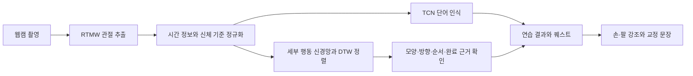

# WordsInSilence

한국 수어를 따라 배우고, 관측된 동작 차이를 시각적 강조와 짧은 교정 문장으로 알려주는 기능성 게임 연구 프로젝트입니다.

## 현재 구현

- **MOA와 연습:** 캐릭터의 사과·감사 시범을 보고 웹캠으로 따라 합니다.
- **촬영 중 관절 추출:** RTMW가 추출한 관절을 종료 후 분석에서 재사용합니다.
- **단어 인식과 세부 분석:** TCN의 단어 후보와 시간 합성곱·GRU 등 세부 판정부의 관측을 구분합니다.
- **피드백:** DTW 정렬, 신체 기준의 상대 위치, 손가락 모양·움직임·완료 근거를 함께 사용합니다. 확인이 어려운 부분은 오류로 단정하지 않습니다.
- **실전 퀘스트:** 인식·판정 결과를 게임 진행과 연결합니다.

현재 판정은 학습된 모델과 공통 관측·판정 규칙을 함께 사용합니다. LLM이 영상을 보고 자유롭게 답변하는 시스템은 아닙니다. 모든 수어 단어와 모든 사용자의 오류를 검증한 상태도 아닙니다.

## 이 저장소의 범위

**공개용 소스 기록**입니다. 개인 촬영, 관절 배열, 원본 데이터셋, 모델 가중치, 개별 촬영 결과, 브라우저 프로필, 캐릭터·영상 자산은 포함하지 않습니다. 코드에 섞여 있던 개인 PC 경로는 공개 사본에서 일반화했습니다.

따라서 이 저장소를 복제하는 것만으로 현재 데모를 실행할 수는 없습니다. 로컬 모델·검증 계약·참고 자산과 실행 환경을 별도로 준비해야 합니다. 실행 패키지와 외부 웹 배포는 별도 준비 단계입니다.

| 위치 | 내용 |
| --- | --- |
| `Assets/_Project/` | Unity의 자체 스크립트·장면·설정·테스트 코드 |
| `Tools/` | 전처리·학습·애니메이션 제작 도구 |
| `research/front_keyphase_v1/` | 웹 판정과 연구·검증 코드, 날짜별 실험 |
| `frontal_demo_launcher.py` | 현재 로컬 웹 데모의 실행 진입점 |
| `docs/` | 구조·재현 범위·데이터 공개 정책 |

- [구조와 현재 한계](docs/ARCHITECTURE.md)
- [실행·재현에 필요한 자료](docs/REPRODUCIBILITY.md)
- [데이터·개인정보 공개 정책](docs/DATA_POLICY.md)
- [공개 전 검사 요약](docs/PUBLICATION_AUDIT.md)

날짜별 연구 코드에는 미채택 후보와 과거 실험도 있습니다. 폴더가 존재한다는 사실만으로 현재 웹에 적용된 기능이나 성능 향상을 의미하지 않습니다.
